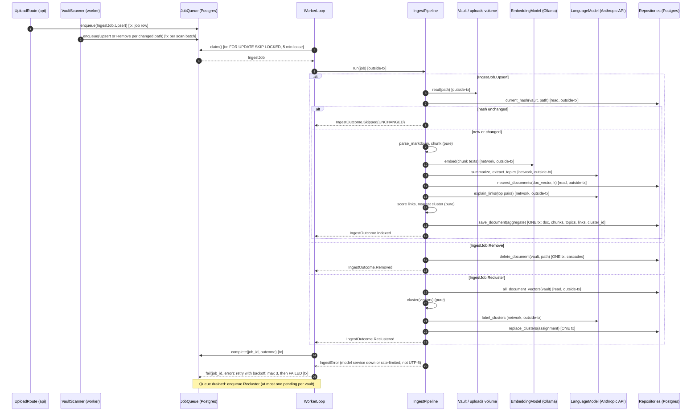

# PRD: Semantic Knowledge Graph App

Nov 8, 2026 · @Someone

## Overview

We are building a knowledge app (working name **Atlas**) that turns uploaded files into a navigable graph of related ideas, with no manual linking required. Users drop in documents; Atlas parses, indexes and embeds them, then links documents and topics by meaning and shows the result as an interactive graph people can travel.

**Problem.** [Obsidian](https://obsidian.md/) proved people want a "personal Wikipedia" with backlinks and a graph view. But its graph only shows links people type by hand (`[[like this]]`). Most knowledge lives in PDFs, slide decks, docs and exports that nobody will ever hand-link, so those connections stay invisible.

**Our answer.** Make connections automatic. Atlas reads the content, finds documents that discuss the same things, extracts shared topics, and draws the graph for you. Manual links are still supported, but they are an addition, not the only source of structure.

**Scope (updated 2026-11-08).** Atlas reads Markdown (`.md`) files only, so there is no OCR or binary-format parsing. It runs entirely on the user's machine with one `docker compose up`, using off-the-shelf Docker images. Embeddings run locally in Ollama; Claude (Anthropic API) writes summaries, topics, link reasons and cluster labels, so note text is sent to Anthropic for those steps.

## Goals, non-goals and success metrics

The MVP succeeds if a new user uploads at least 20 documents and finds a useful connection they did not know about in their first session.

**Goals**

1. Point Atlas at a folder of Markdown files (or upload them) and have them searchable within minutes.
2. Link related documents automatically by meaning, with a reason shown for each link.
3. Surface the topics that recur across documents and connect documents through them.
4. Let users explore the graph: zoom, filter, follow neighbors, and open any document from it.
5. Combine keyword and semantic search, with results placed in the graph.

**Non-goals (MVP)**

- Any format other than Markdown (PDF, DOCX, slides, images) and OCR.
- Cloud hosting, accounts or multi-tenant SaaS; a plugin ecosystem.
- Real-time multi-user editing.
- Publishing notes as a public website.
- Native mobile apps (responsive web only).

**Success metrics**

| Metric | Target (90 days after launch) |
| --- | --- |
| Activation: users who upload 20+ docs in week 1 | 40% |
| Users who click from one doc to a linked doc in session 1 | 60% |
| Link relevance: "useful" votes on suggested links | 70%+ |
| Time from file save to doc appearing in graph (p95, 5,000-word .md) | under 60 s |
| Week-4 retention | 30% |

## Target users and use cases

The primary user is a knowledge worker with a pile of documents and no time to organize them.

| Persona | Their pile | What they want from Atlas |
| --- | --- | --- |
| Researcher / grad student | 100s of Markdown notes and paper summaries | See which papers share methods or findings; find gaps |
| Product manager / analyst | Specs, interview notes, market reports | Trace a theme (e.g. "onboarding friction") across sources |
| Consultant / sales lead | Client decks, call notes, proposals | Reuse past work; find similar past engagements |
| Small team (later phase) | Shared drive of docs | A team knowledge map new hires can explore |

**Key use cases**

- "I uploaded my reading folder. Show me the clusters."
- "I'm reading this doc. What else do I have that's like it, and why?"
- "Show me everything connected to the topic *pricing*."
- "Search for *churn*, then let me walk outward from the best hit."

## Lessons from Obsidian

We borrow Obsidian's graph view, backlinks and data-ownership stance, and differ by building structure from content instead of typed links.

| Obsidian feature | What Atlas does |
| --- | --- |
| Links and backlinks (typed `[[links]]`) | Parse \[\[wikilinks\]\] and #tags as explicit links (P0); add automatic **semantic links** with a similarity score and a short reason |
| Graph view of notes | Graph of **documents and topics**; edges weighted by similarity; clusters colored by theme |
| Local Markdown files, open formats | Same: reads a mounted folder of .md files in place, read-only; an existing Obsidian vault works as-is |
| Private by default | Different: embeddings and search stay local (Ollama); note text goes to the Anthropic API for summaries, topics and link reasons |
| Canvas (infinite whiteboard) | Out of MVP; later phase could let users pin graph nodes onto a canvas |
| Plugins and themes | Out of MVP |
| Sync (E2E encrypted) and shared vaults | Out of scope: local-only; users sync the folder with their own tools (git, iCloud, Obsidian Sync) |
| Publish (public wiki) | Out of MVP |

Source: [obsidian.md](https://obsidian.md/), opened 2026-11-08.

## Functional requirements

Six areas; P0 = MVP, P1 = fast follow, P2 = later.

### 1. Upload and ingestion

| ID | Requirement | Priority |
| --- | --- | --- |
| UP-1 | Index a host folder of .md files mounted read-only into the container (e.g. an Obsidian vault) | P0 |
| UP-2 | Drag-and-drop upload of .md files or a zipped folder in the web UI | P0 |
| UP-3 | Only `.md` / `.markdown` accepted; other files skipped and listed as "ignored" | P0 |
| UP-4 | Per-file status: queued, indexing, linked, failed (with reason) | P0 |
| UP-5 | Skip unchanged files by content hash; a changed file is re-indexed, not duplicated | P0 |
| UP-6 | Watch the mounted folder and re-index files on save, rename or delete | P1 |
| UP-7 | Max 5 MB per file; tested to 10,000 files per vault | P0 |

### 2. Indexing

| ID | Requirement | Priority |
| --- | --- | --- |
| IX-1 | Parse Markdown: YAML frontmatter, headings, \[\[wikilinks\]\], #tags; strip code blocks and images from embedding text | P0 |
| IX-2 | Split into chunks that follow document structure (\~500 tokens, with overlap) | P0 |
| IX-3 | Embed every chunk and a document-level summary | P0 |
| IX-4 | Full-text keyword index alongside the vector index | P0 |
| IX-5 | Auto-generate title, 2-sentence summary and tags for each document | P0 |
| IX-6 | Re-index incrementally when a file changes or is deleted | P0 |

### 3. Semantic linking

| ID | Requirement | Priority |
| --- | --- | --- |
| SL-1 | Link each document to its most similar documents above a similarity threshold (default top 8) | P0 |
| SL-2 | Each link shows a score and a one-line reason plus the matching passages from both docs | P0 |
| SL-3 | Users can confirm, hide or manually add links; feedback tunes future suggestions | P0 |
| SL-4 | `[[wikilinks]]` (incl. aliases and `#heading` anchors) become explicit links; unresolved targets show as ghost nodes, as in Obsidian | P0 |
| SL-5 | Frontmatter `tags:` and inline `#tags` become topic edges | P0 |
| SL-6 | Link types beyond similarity: "cites", "contradicts", "extends" | P2 |

### 4. Topic extraction

| ID | Requirement | Priority |
| --- | --- | --- |
| TP-1 | Extract key topics and named entities (people, orgs, concepts) per document | P0 |
| TP-2 | Merge duplicates into one canonical topic ("ML" = "machine learning") | P0 |
| TP-3 | Cluster documents into themes, with an auto-generated label per cluster | P0 |
| TP-4 | Users can rename, merge, split or delete topics | P1 |
| TP-5 | Topic page: definition, all linked docs, related topics | P1 |

### 5. Graph visualization

| ID | Requirement | Priority |
| --- | --- | --- |
| GR-1 | Global graph: documents and topics as nodes, links as edges; force-directed layout | P0 |
| GR-2 | Node size by connections; color by cluster or file type; edge thickness by similarity | P0 |
| GR-3 | Pan, zoom, drag; hover shows title + summary; click opens a side panel | P0 |
| GR-4 | Local graph: the selected node and its neighbors 1-3 hops out (depth slider) | P0 |
| GR-5 | Filters: file type, date, tag, cluster, similarity threshold, show/hide topics | P0 |
| GR-6 | "Travel" mode: from a node, step to a neighbor; breadcrumb trail of the path taken; back/forward | P0 |
| GR-7 | Smooth at 5,000 nodes / 50,000 edges (WebGL rendering) | P0 |
| GR-8 | Save a view (filters + position) and share a link to it | P1 |
| GR-9 | Timeline mode: watch the graph grow by upload or document date | P2 |

### 6. Search and document view

| ID | Requirement | Priority |
| --- | --- | --- |
| SR-1 | Hybrid search (keyword + semantic) with result snippets | P0 |
| SR-2 | Highlight results in the graph and jump to the best match | P0 |
| SR-3 | Ask a question and get an answer with citations to passages (RAG) | P1 |
| DV-1 | Document view: rendered Markdown, frontmatter, summary, tags | P0 |
| DV-2 | Side rail: related docs, topics and backlinks (Obsidian-style) | P0 |
| DV-3 | Create lightweight Markdown notes that join the graph like any doc | P1 |

## User flows

Three flows cover the MVP; each ends with the user in the graph.

**A. Upload to graph (first run)**

1. User sets VAULT\_PATH in .env, runs docker compose up, and opens localhost:3000. If no vault is mounted, the page says "Drop your .md files here."
2. Atlas scans the mounted folder (or the 40 files they drop). A progress tray shows each file's status.
3. As files finish, nodes appear in the graph live and settle into clusters.
4. When done, Atlas shows a summary card: "40 documents, 6 themes, 112 connections" with the top 3 themes to explore.
5. User clicks a theme; the graph zooms to that cluster.

**B. Traveling the graph**

1. User clicks a document node. The side panel shows its summary, topics and related docs, each with a reason.
2. They switch to local graph (depth 2) to see only nearby nodes.
3. They click a neighbor to step to it. The breadcrumb trail records the path: *Doc A > topic "pricing" > Doc F*.
4. On any edge they can open "Why connected?" to see matching passages side by side.
5. They mark a link useful or hide it, and can save the path as a view.

**C. Search to graph**

1. User types "customer churn" in the search bar (Cmd+K).
2. Results list hybrid matches with snippets; matching nodes glow in the graph.
3. Picking a result centers the graph on it in local mode; from there the user continues as in flow B.

## System architecture

A web client and API sit on top of one async ingestion pipeline; Postgres with pgvector holds text, vectors, topics and links, so search and the graph read from a single store.

&#91;embedded content: system architecture · 5-step ingestion pipeline\]

The client uploads files straight to object storage, then the API queues one job per file. Step 5 (accented) is what makes this product different: it turns vectors into the links and clusters the graph draws.

**How each step works**

1. **Parse.** Read the .md file; split off YAML frontmatter; build a heading tree; collect \[\[wikilinks\]\] and #tags; drop code blocks and image embeds from the text to embed. No OCR is needed.
2. **Chunk.** Split along headings into \~500-token chunks with \~50 tokens of overlap, keeping the heading path for context.
3. **Embed.** Embed each chunk, plus an LLM-written summary for a document-level vector.
4. **Topics.** An LLM extracts topics and entities per document; new topics are matched to existing ones by embedding similarity to merge aliases.
5. **Link and cluster.** For each document, find nearest neighbors by doc vector, re-score with chunk-to-chunk matches, keep those above threshold, and have an LLM write a one-line reason. Cluster docs (e.g. HDBSCAN on doc vectors) and label each cluster with an LLM. Recompute neighbors of affected docs incrementally on each upload.

**Local stack (Docker Compose)**

Five services: db and ollama run stock images unchanged; `web` and `api`/`worker` are our code built on stock base images.

| Service | Docker image | Role |
| --- | --- | --- |
| web | built on `node:22-alpine`, served by `nginx:1.27-alpine` | React + Vite UI; Sigma.js / graphology WebGL graph; proxies `/api` |
| api | built on `python:3.12-slim` (Python 3.12 + FastAPI) | FastAPI: upload, hybrid search, graph and document endpoints |
| worker | same image as `api`, different command | Runs the 5-step ingestion pipeline; watches the vault folder |
| db | `pgvector/pgvector:pg16` | Postgres 16 + pgvector: docs, chunks, vectors, topics, links, full-text index, job queue |
| ollama | `ollama/ollama` | Embeddings only: `nomic-embed-text` (768-d) |

**LLM: Anthropic API (not a container).** `api` and `worker` call Claude through the official `anthropic` Python SDK, with `ANTHROPIC_API_KEY` set in `.env`. The model is `claude-opus-5-5` by default and can be changed with `ATLAS_LLM_MODEL`. Structured outputs (`output_config.format`) return typed JSON for summaries, topics and link reasons. A large first import goes through the Message Batches API, which costs 50% less.

```yaml
# docker-compose.yml (sketch)
services:
  db:
    image: pgvector/pgvector:pg16
    environment: { POSTGRES_DB: atlas, POSTGRES_USER: atlas, POSTGRES_PASSWORD: atlas }
    volumes: [pgdata:/var/lib/postgresql/data]
  ollama:
    image: ollama/ollama
    volumes: [ollama:/root/.ollama]
  api:
    build: ./api
    environment: { DATABASE_URL: postgresql://atlas:atlas@db/atlas, OLLAMA_URL: http://ollama:11434, ANTHROPIC_API_KEY: "${ANTHROPIC_API_KEY}" }
    volumes: ["${VAULT_PATH}:/vault:ro"]
    depends_on: [db, ollama]
  worker:
    build: ./api
    command: python -m atlas.worker
    environment: { DATABASE_URL: postgresql://atlas:atlas@db/atlas, OLLAMA_URL: http://ollama:11434, ANTHROPIC_API_KEY: "${ANTHROPIC_API_KEY}" }
    volumes: ["${VAULT_PATH}:/vault:ro"]
    depends_on: [db, ollama]
  web:
    build: ./web
    ports: ["3000:80"]
    depends_on: [api]
volumes: { pgdata: {}, ollama: {} }
```

**Alternatives considered**

| Decision | Chosen | Rejected | Why |
| --- | --- | --- | --- |
| Vector store | pgvector in Postgres | `qdrant/qdrant` | One store; vectors, text and links update in one transaction |
| Job queue | Postgres table + `FOR UPDATE SKIP LOCKED` | `redis:7-alpine` + Celery | One less container; the job row is written in the same transaction as the document, so no job is lost |
| Keyword search | Postgres full-text (`tsvector`) | `getmeili/meilisearch` | Good enough at 10k docs; no second index to sync |
| Graph store | `links` table in Postgres | `neo4j:5` | Graph is small (10k nodes); layout runs in the browser, so no graph queries need a graph DB |
| Models | `ollama/ollama` | `ghcr.io/huggingface/text-embeddings-inference` | Embeddings: Ollama stays local and free. LLM: Claude via the Anthropic API gives far better topics and reasons than a small local model, with no GPU needed |

**Mac note.** Docker on macOS cannot use the Apple GPU, so Ollama in a container runs on CPU. It now only serves a small embedding model, which runs acceptably on CPU. A `host-ollama` Compose profile points `OLLAMA_URL` at `host.docker.internal:11434` for users who run Ollama natively. On Linux with NVIDIA, the `ollama` service can reserve the GPU.

## Data model

Eight core entities, all scoped to a workspace; the graph is derived from Document, Topic and Link rows.

| Entity | Key fields | Notes |
| --- | --- | --- |
| Workspace | id, name, root\_path, settings (link threshold, top-k) | One indexed folder (vault); an install can hold several |
| Document | id, workspace\_id, title, path, frontmatter (jsonb), content\_hash, version, status, summary, tags\[\], doc\_embedding, created\_at | Status: queued / indexing / linked / failed; unique on (workspace\_id, path) |
| Chunk | id, document\_id, ordinal, text, page/heading path, embedding, tsvector | Unit of search and passage matching |
| Topic | id, workspace\_id, canonical\_name, aliases\[\], kind (concept / person / org), embedding, cluster\_id | Shared node across documents |
| DocumentTopic | document\_id, topic\_id, salience (0-1) | Document-to-topic edge |
| Link | id, source\_doc\_id, target\_doc\_id, score, reason, evidence\_chunk\_ids\[\], origin (semantic / wiki / tag); written only by IngestPipeline | Document-to-document edge |
| Cluster | id, workspace\_id, label, centroid, color | Theme grouping for color and filters |
| SavedView | id, workspace\_id, name, filters, camera, path\[\] | Shareable graph view (P1) |

LinkFeedback (doc\_a\_id, doc\_b\_id, verdict: confirmed / hidden / added, created\_at) is written only by LinkFeedbackRoute; a re-index never touches it.

## Non-functional requirements

The bar: documents appear in the graph within a minute, the graph stays smooth at 5,000 nodes, and no one but the owner can read their files.

| Area | Requirement |
| --- | --- |
| Setup | `git clone` + `docker compose up` to a working UI in under 10 min on first run (incl. embedding model pull, \~300 MB); needs an Anthropic API key |
| Host resources | Runs on a laptop with 16 GB RAM, 4 cores, 10 GB free disk; no GPU required |
| Ingestion speed | 1,000 .md files (avg 1,500 words) embedded and linked in under 20 min on CPU; LLM summaries and link reasons may finish later in the background |
| Incremental update | A saved file shows its new links in under 30 s (P1, with folder watch) |
| Search latency | Hybrid search under 300 ms (p95) at 10,000 docs |
| Graph performance | 60 fps pan/zoom at 5,000 nodes; initial graph load under 2 s |
| Privacy | The only outbound calls go to the Anthropic API (note text for summaries, topics, link reasons, cluster labels); embeddings, search and the graph stay local; the UI is bound to `localhost`; an embeddings-only mode sends nothing out |
| Data safety | Vault mounted read-only; Atlas never writes to the user's files; deleting the `pgdata` volume resets everything |
| Portability | Same Compose file on macOS (Apple silicon + Intel), Linux and Windows (WSL2); multi-arch images only |
| Accessibility | WCAG 2.1 AA; a list view of every graph view for keyboard and screen-reader users |

**Claude cost (rough estimate, to measure on real notes).** Assuming \~4k input and \~800 output tokens per 1,500-word note: `claude-opus-5-5` ($4 / $20 per M tokens) is about $0.03 per note, roughly $30 per 1,000 notes, or half that through the Batches API. `claude-haiku-5-5` ($0.10 / $0.50) would be under $1 per 1,000 notes. Re-indexing an unchanged note costs nothing, because unchanged hashes are skipped.

## Data flow design

All four outputs below were signed off on 2026-11-08, so implementation can start. Build order: docker-compose.yml, schema migrations, then the pipeline.

| Question | Proposed answer | Status |
| --- | --- | --- |
| Who triggers ingestion? | Two entry points, one path: a UI upload (API) or a vault scan/watch (worker). Both enqueue one `IngestJob` per file | Signed off 2026-11-08 |
| Unit of consistency | One document: the Document row, its chunks, its topic edges and its explicit `[[wikilink]]` links commit in one transaction. Its semantic links commit in that same transaction at the end of the pipeline job. All model calls (Ollama and Anthropic) finish before the transaction opens. Other docs' top-k lists catch up when they are next re-indexed | Revised 2026-11-08 (single pipeline) |
| Failure budget | At-least-once job delivery; idempotent by `(workspace_id, path, content_hash)`, so re-running a job is a no-op | Signed off 2026-11-08 |
| Backend language | Python 3.12 + FastAPI on python:3.12-slim; Pydantic models and tagged unions for types | Decided 2026-11-08 |

**Services (B1, signed off 2026-11-08).** One `IngestPipeline` runs parse, chunk, embed, topics, KNN + link reasons and clustering for each file, then writes everything in one transaction. Around it: `UploadRoute` and `VaultScanner` (entry points), `JobQueue` (Postgres), and read-only `SearchService` and `GraphService`. Link feedback (signed off): user confirm/hide verdicts live in a separate link\_feedback table written only by LinkFeedbackRoute, so the pipeline stays the only writer of the `links` table; GraphService joins the two. Clustering (signed off): per file, the pipeline assigns the nearest existing cluster in the same transaction; a full re-cluster runs once when the queue drains, or on demand.

### Output 1: call graph (signed off 2026-11-08)

Every network call to the model services happens before the single write transaction opens. Update 2026-11-08: LanguageModel is now backed by the Anthropic API; the ports and call graph are unchanged. Each job type ends in exactly one transaction.



**Rules the diagram depends on**

- One active or pending job per (vault, path): a newer enqueue replaces a pending one, so an old job can never overwrite a newer version of the file.
- `save_document` also checks the stored hash has not changed since step 7; if it has, the outcome is `Skipped(SUPERSEDED)`.
- Wikilinks are stored by target name, not target id. GraphService resolves them at read time, so a new note never has to rewrite other notes' links, and unresolved names show as ghost nodes.
- Link feedback (`LinkFeedbackRoute -> link_feedback`, one tx) is outside this flow.

### Output 2: interface signatures (signed off 2026-11-08)

Ports are `typing.Protocol`s; IDs are `NewType`s so a `DocumentId` can't be passed where a `VaultId` is expected. No signature names a vendor (Ollama is only the adapter), and no method takes a behavior-switching boolean.

```python
from datetime import timedelta
from typing import Literal, NewType, Protocol, Sequence
from uuid import UUID

VaultId = NewType("VaultId", UUID)
DocumentId = NewType("DocumentId", UUID)
ClusterId = NewType("ClusterId", UUID)
JobId = NewType("JobId", UUID)
VaultPath = NewType("VaultPath", str)      # POSIX path relative to vault root: "notes/ideas.md"
ContentHash = NewType("ContentHash", str)  # sha256 hex of the file bytes
Embedding = tuple[float, ...]               # 768-d
Depth = Literal[1, 2, 3]

# ---- Queue and entry points -------------------------------------------
class JobQueue(Protocol):
    def enqueue(self, job: IngestJob) -> JobId: ...           # replaces a pending job for the same (vault, path)
    def claim(self, lease: timedelta) -> ClaimedJob | None: ...
    def complete(self, job_id: JobId, outcome: IngestOutcome) -> None: ...
    def fail(self, job_id: JobId, error: IngestError) -> RetryDecision: ...

class VaultScanner(Protocol):
    def scan(self, vault: VaultId) -> ScanReport: ...         # enqueues Upsert / Remove for changed paths only

# ---- Pipeline (the one deep module) -------------------------------------
class IngestPipeline(Protocol):
    def run(self, job: IngestJob) -> IngestOutcome | IngestError: ...

# Pure functions: private module-level helpers of the pipeline, no I/O
def parse_markdown(path: VaultPath, raw: str) -> ParsedNote: ...
def chunk(note: ParsedNote, max_tokens: int = 500, overlap: int = 50) -> list[Chunk]: ...
def score_links(candidates: Sequence[Neighbor], threshold: float, k: int) -> list[ScoredPair]: ...
def nearest_cluster(vector: Embedding, centroids: Sequence[ClusterCentroid]) -> ClusterId | None: ...
def cluster(vectors: Sequence[DocumentVector]) -> ClusterAssignment: ...

# ---- Model ports: EmbeddingModel <- Ollama adapter; LanguageModel <- Anthropic SDK adapter
class EmbeddingModel(Protocol):
    def embed(self, texts: Sequence[str]) -> list[Embedding]: ...       # raises ModelUnavailable

class LanguageModel(Protocol):
    def summarize(self, note: ParsedNote) -> NoteSummary: ...
    def extract_topics(self, note: ParsedNote) -> list[TopicMention]: ...
    def explain_links(self, pairs: Sequence[LinkEvidence]) -> list[LinkReason]: ...
    def label_clusters(self, samples: Sequence[ClusterSample]) -> list[ClusterLabel]: ...

# ---- Repositories (Postgres) ---------------------------------------------
class DocumentRepository(Protocol):
    def current_hash(self, vault: VaultId, path: VaultPath) -> ContentHash | None: ...
    def nearest_documents(self, vault: VaultId, vector: Embedding, k: int, exclude: VaultPath) -> list[Neighbor]: ...
    def save_document(self, aggregate: DocumentAggregate, expected_hash: ContentHash | None) -> SaveResult: ...
    def delete_document(self, vault: VaultId, path: VaultPath) -> None: ...   # no-op when absent
    def all_document_vectors(self, vault: VaultId) -> list[DocumentVector]: ...

class ClusterRepository(Protocol):
    def centroids(self, vault: VaultId) -> list[ClusterCentroid]: ...
    def replace_clusters(self, vault: VaultId, assignment: ClusterAssignment, labels: Sequence[ClusterLabel]) -> None: ...

class LinkFeedbackRepository(Protocol):
    def record(self, vault: VaultId, pair: DocumentPair, verdict: LinkVerdict) -> None: ...  # upsert, idempotent

# ---- Read side (api) ----------------------------------------------------
class SearchService(Protocol):
    def search(self, vault: VaultId, query: SearchQuery) -> list[SearchHit]: ...

class GraphService(Protocol):
    def global_graph(self, vault: VaultId, filters: GraphFilters) -> GraphView: ...
    def local_graph(self, vault: VaultId, center: NodeRef, depth: Depth) -> GraphView: ...
    def link_evidence(self, vault: VaultId, pair: DocumentPair) -> LinkEvidenceView | None: ...
```

**HTTP routes (FastAPI)**

| Route | Calls | Idempotent by |
| --- | --- | --- |
| `POST /api/uploads` | write to uploads volume, `JobQueue.enqueue` | content hash |
| `POST /api/vaults/{id}/scan` | `VaultScanner.scan` | changed paths only |
| `GET /api/search?q=` | `SearchService.search` | read |
| `GET /api/graph`, `GET /api/graph/local/{node}?depth=` | `GraphService` | read |
| `GET /api/links/{a}/{b}` | `GraphService.link_evidence` | read |
| `PUT /api/links/{a}/{b}/feedback` | `LinkFeedbackRepository.record` | PUT on the pair |
| `POST /api/vaults/{id}/recluster` | `JobQueue.enqueue(Recluster)` | one pending per vault |

Design notes: `GraphFilters` carries `layers: frozenset[NodeKind]` instead of a `show_topics: bool`; `DocumentPair` is ordered (smaller id first) so (a, b) and (b, a) are one row; ports raise typed exceptions, and `IngestPipeline.run` is the single place that turns them into an `IngestError` value.

### Output 3: type hierarchies (signed off 2026-11-08)

Python's version of sealed classes is a closed union of frozen Pydantic models with a `kind` discriminator. Dispatch is always an exhaustive `match` checked by `mypy --strict` (`assert_never`). Job payloads are stored as `jsonb` in the queue table, which is why these are Pydantic models.

```python
from enum import StrEnum
from typing import Annotated, ClassVar, Literal
from pydantic import BaseModel, ConfigDict, Field

class Frozen(BaseModel):
    model_config = ConfigDict(frozen=True)

# ---- IngestJob: what the worker is asked to do -------------------------
class JobBase(Frozen):
    vault: VaultId                          # lifted: every job targets one vault

class FileJob(JobBase):
    path: VaultPath                         # lifted: only file jobs carry a path

class Upsert(FileJob):
    kind: Literal["upsert"] = "upsert"
    origin: Literal["vault", "upload"]      # which root to read the path from

class Remove(FileJob):
    kind: Literal["remove"] = "remove"

class Recluster(JobBase):
    kind: Literal["recluster"] = "recluster"

IngestJob = Annotated[Upsert | Remove | Recluster, Field(discriminator="kind")]

# ---- IngestOutcome: what happened (all are successes) -------------------
class SkipReason(StrEnum):
    UNCHANGED = "unchanged"                 # same content hash as stored
    SUPERSEDED = "superseded"               # file changed while this job ran

class Indexed(Frozen):
    kind: Literal["indexed"] = "indexed"
    document_id: DocumentId
    path: VaultPath
    link_count: int
    topic_count: int
    cluster_id: ClusterId | None            # None until the first Recluster creates clusters

class Skipped(Frozen):
    kind: Literal["skipped"] = "skipped"
    path: VaultPath
    reason: SkipReason

class Removed(Frozen):
    kind: Literal["removed"] = "removed"
    path: VaultPath                         # also returned when the doc was already gone

class Reclustered(Frozen):
    kind: Literal["reclustered"] = "reclustered"
    cluster_count: int

IngestOutcome = Annotated[Indexed | Skipped | Removed | Reclustered, Field(discriminator="kind")]

# ---- IngestError: only failures that can really happen ------------------
class ModelUnavailable(Frozen):
    kind: Literal["model_unavailable"] = "model_unavailable"
    retryable: ClassVar[bool] = True
    detail: str

class ModelTimeout(Frozen):
    kind: Literal["model_timeout"] = "model_timeout"
    retryable: ClassVar[bool] = True
    step: Literal["embed", "summarize", "topics", "explain_links", "label_clusters"]

class NotUtf8(Frozen):
    kind: Literal["not_utf8"] = "not_utf8"
    retryable: ClassVar[bool] = False
    path: VaultPath

IngestError = Annotated[ModelUnavailable | ModelTimeout | NotUtf8, Field(discriminator="kind")]

# ---- Persistence and queue results --------------------------------------
class Saved(Frozen):
    kind: Literal["saved"] = "saved"
    document_id: DocumentId

class Superseded(Frozen):
    kind: Literal["superseded"] = "superseded"
    stored_hash: ContentHash

SaveResult = Saved | Superseded

class RetryAt(Frozen):
    kind: Literal["retry_at"] = "retry_at"
    at: datetime
    attempt: int

class GaveUp(Frozen):
    kind: Literal["gave_up"] = "gave_up"
    attempts: int

RetryDecision = RetryAt | GaveUp

# ---- Graph: links and nodes ---------------------------------------------
class SemanticLink(Frozen):
    kind: Literal["semantic"] = "semantic"
    pair: DocumentPair                      # ordered, so one row per pair
    score: float                            # cosine similarity, 0-1
    reason: str | None                      # None until the LLM explains it
    evidence: tuple[ChunkId, ChunkId]

class WikiLink(Frozen):
    kind: Literal["wiki"] = "wiki"
    source: DocumentId
    target_name: str                        # resolved at read time; may stay unresolved
    anchor: str | None                      # [[Note#Heading]]

Link = Annotated[SemanticLink | WikiLink, Field(discriminator="kind")]

class DocumentNode(Frozen):
    kind: Literal["document"] = "document"
    id: DocumentId

class TopicNode(Frozen):
    kind: Literal["topic"] = "topic"
    id: TopicId

class GhostNode(Frozen):
    kind: Literal["ghost"] = "ghost"
    name: str                               # a [[wikilink]] with no matching note

NodeRef = Annotated[DocumentNode | TopicNode | GhostNode, Field(discriminator="kind")]

class LinkVerdict(StrEnum):
    CONFIRMED = "confirmed"
    HIDDEN = "hidden"
    ADDED = "added"                         # user-drawn link between two docs
```

**Errors defined out of existence**

| Would-be error | Why it can't happen |
| --- | --- |
| Not a Markdown file | `VaultPath` is only built by a parser that accepts `.md` / `.markdown`; others are listed as "ignored" at scan or upload |
| File too large | Rejected at scan or upload (5 MB cap) before a job exists |
| File vanished before read | The pipeline treats it as `Remove` and returns `Removed` |
| Document not found on delete | `delete_document` is a no-op; outcome is still `Removed` |
| LLM returned bad JSON | Summary, topics and reasons are enrichment: stored as `None` / empty and retried on the next re-index; the doc is still `Indexed` |
| Wikilink target missing | Shown as a `GhostNode`, the same way Obsidian does |
| Semantic link with no score | `SemanticLink` and `WikiLink` are separate types; only one has a score |

Claude-specific cases are handled the same way. A `refusal` or `max_tokens` stop reason leaves that enrichment as `None`, and the doc is still `Indexed`. A 429 or 5xx that survives the SDK's retries becomes `ModelUnavailable` and is retried by the queue. A missing `ANTHROPIC_API_KEY` stops `api` and `worker` at startup, not inside a job, unless embeddings-only mode is on.

### Output 4: layer responsibilities (signed off 2026-11-08)

Each table has exactly one writer: `IngestPipeline` (through `DocumentRepository` and `ClusterRepository`), `JobQueue`, or `LinkFeedbackRepository`.

| Layer | Accepts | Returns | Owns exclusively | Does NOT |
| --- | --- | --- | --- | --- |
| FastAPI routes (`api`) | HTTP request, multipart .md upload | JSON DTOs | Input parsing into `VaultPath` / IDs; upload size and extension checks; `localhost` binding | Business rules; DB writes other than enqueue and link feedback; model calls |
| Worker loop (`worker`) | `ClaimedJob` from `JobQueue` | nothing (calls `complete` / `fail`) | Claim, lease, retry with backoff, enqueue `Recluster` when the queue drains | Parsing, scoring, any table other than `jobs` |
| `VaultScanner` (`worker`) | `VaultId` | `ScanReport` | Walking `/vault`, hash comparison, Upsert / Remove enqueue | Reading file content beyond hashing; writing documents |
| `IngestPipeline` | `IngestJob` | `IngestOutcome \| IngestError` | Pipeline order; turning port exceptions into `IngestError`; the one write transaction per job | HTTP; retry policy; opening a transaction around a model call |
| Pure functions | Parsed values | Values | Markdown parsing, chunking, link scoring, nearest cluster, clustering | Any I/O, clock or randomness without a seed |
| Model adapters (`EmbeddingModel`, `LanguageModel`) | Text, `ParsedNote`, evidence | Embeddings, typed summaries / topics / reasons | Ollama HTTP for embeddings; the anthropic SDK for Claude (structured outputs, Batches API for imports, prompt caching, SDK retries on 429/5xx); prompts; timeouts | Persistence; deciding what to do on failure (they raise) |
| Repositories | Domain aggregates, IDs | Domain values, `SaveResult` | SQL, pgvector queries, transactions, the stale-hash check in `save_document` | Decisions; validation beyond DB constraints |
| `JobQueue` | `IngestJob`, `JobId` | `ClaimedJob`, `RetryDecision` | `jobs` table, `SKIP LOCKED` claim, one-pending-per-(vault, path) rule | Running jobs |
| Read services (`SearchService`, `GraphService`) | `VaultId`, query, filters | `SearchHit`s, `GraphView` | Hybrid ranking, wikilink resolution, joining `link_feedback` into the graph | Any write |

**Python layout (proposed)**

```text
api/
  atlas/
    http/          # FastAPI routes + DTOs
    worker.py      # worker loop + VaultScanner
    pipeline/      # IngestPipeline + pure functions (markdown.py, chunking.py, scoring.py, clustering.py)
    models/        # EmbeddingModel / LanguageModel protocols + Ollama adapters
    store/         # repositories, JobQueue, SQL migrations (Alembic)
    read/          # SearchService, GraphService
    types.py       # NewTypes + the unions from Output 3
  Dockerfile       # FROM python:3.12-slim
```

## Roadmap

The MVP (all P0 requirements) is scoped to 12 weeks for a team of 3-4 engineers and 1 designer; durations are proposals to validate with engineering.

&#91;embedded content: proposed roadmap · 3 phases, 2 gates\]

Phase 2 starts only once beta users find the links useful; Phase 3 waits for proof of retention and demand for shared workspaces.

## Risks and open questions

The biggest risk is a graph that looks impressive but connects things users don't find useful.

| Risk | Impact | Mitigation |
| --- | --- | --- |
| Weak or noisy links ("everything relates to everything") | Users stop trusting the graph | Per-vault adaptive threshold; show reasons and evidence; learn from confirm/hide feedback |
| Hairball graph at scale | Graph unreadable past \~500 nodes | Default to cluster view, collapse clusters into super-nodes, local graph as main mode |
| API cost and rate limits on a big first import | Surprise bill or 429s on a 10,000-note vault | Show an estimated cost before the first import; use the Batches API for imports; embeddings first so the graph appears early; cache the shared system prompt; `host-ollama` and ATLAS\_LLM\_MODEL to switch models |
| Messy Markdown (odd frontmatter, broken links, huge files) | Missing links or failed files | Lenient parser; per-file error with reason; unresolved links shown as ghost nodes; 5 MB cap |
| Note text leaves the machine | Users with sensitive vaults won't adopt | Clear notice at setup; embeddings-only mode with no LLM calls (no summaries or reasons, links still work); per-folder exclude list |
| Topic sprawl (thousands of near-duplicate topics) | Cluttered graph and filters | Embedding-based topic merging; minimum document count before a topic shows |

**Open questions**

- [ ] Resolved: Python + FastAPI, which sets the `api`/`worker` base image and the signatures in the data flow design.
- [ ] Should topics be first-class nodes by default, or an optional layer over a document-only graph?
- [ ] Default Claude model: `claude-opus-5-5` (best quality, est. \~$30 per 1,000 notes) or `claude-haiku-5-5` (est. under $1 per 1,000 notes)?
- [ ] One vault per install, or several vaults side by side?
- [ ] Working name "Atlas" is a placeholder; final product name TBD.
